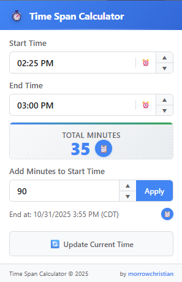

# ⏱️ Time Span Calculator - Chrome Extension

A professional time duration calculator Chrome extension that helps calculate time differences and add minutes to times with smart parsing and beautiful formatting.


## 📸 Screenshots



## ✨ Features

- **⏰ Smart Time Calculator** - Calculate minutes between two times instantly
- **🕐 Duration Breakdown** - See the result as hours and minutes (e.g. 1h 30m) alongside total minutes
- **🔄 Swap Times** - One click swaps the start and end times
- **🌍 Local Timezone** - Uses your system's timezone for "Now" and formatted output (no longer Central-only)
- **➕ Add Minutes Functionality** - Add X minutes to start time with formatted result output
- **🎯 Smart Time Parsing** - Supports multiple input formats (9a, 930a, 9:30 AM, etc.)
- **⚡ Quick Time Selection** - Dropdown with common times and "Now" option
- **📋 Copy to Clipboard** - One-click copying of results and formatted times
- **💾 Persistent Storage** - Remembers your last used times between sessions
- **🎨 Professional UI** - Clean, modern interface with smooth animations
- **⌨️ Keyboard Friendly** - Arrow keys for minute adjustments, Enter for navigation

## 🚀 Installation

### Method 1: Load Unpacked (Development)
1. **Download or clone this repository**
   ```bash
   git clone https://github.com/morrowchristian/timespan-calculator.git
   ```

2. **Open Chrome** and navigate to:
   ```
   chrome://extensions/
   ```

3. **Enable Developer Mode** - toggle in the top right corner

4. **Click "Load Unpacked"** and select the extension folder

5. **Pin the extension** - click the puzzle piece icon and pin Time Span Calculator

### Method 2: Chrome Web Store
*Coming soon!*

## 🎮 How to Use

### Basic Time Calculation
1. **Enter Start Time** - Type or use dropdown to select start time
2. **Enter End Time** - Type or use dropdown to select end time  
3. **View Result** - Total minutes calculated automatically
4. **Copy** - Click the copy button to copy minutes to clipboard

### Add Minutes Feature
1. **Set Start Time** - Enter your starting time
2. **Adjust Minutes** - Use the number input or ▲▼ buttons to set minutes to add
3. **Click Apply** - See the calculated end time with full date formatting
4. **Copy Formatted Time** - Copy the result in `MM/DD/YYYY HH:MM AM/PM (TZ)` format

### Supported Time Formats
- `9a` → `09:00 AM`
- `930a` → `09:30 AM`  
- `9:30a` → `09:30 AM`
- `2p` → `02:00 PM`
- `2:30p` → `02:30 PM`
- `14:30` → `02:30 PM`
- `09:30 AM` → `09:30 AM`

## 🏗️ Project Structure

```
timespan-calculator/
├── 📄 popup.html                 # Main extension popup
├── 📄 manifest.json              # Extension configuration
├── 📁 icons/                     # Extension icons
│   ├── icon16.png
│   ├── icon48.png
│   └── icon128.png
├── 📁 styles/                    # Modular CSS architecture
│   ├── main.css                  # Variables and base styles
│   ├── layout.css                # Layout and structure
│   ├── components.css            # UI components
│   └── utilities.css             # Utilities and animations
└── 📁 scripts/                   # Modular JavaScript architecture
    ├── main.js                   # Application orchestrator
    ├── time-calculations.js      # Time math and formatting
    ├── time-inputs.js            # Input parsing and validation
    ├── storage.js                # Chrome storage management
    └── ui-components.js          # UI interactions and components
```

## 🔧 Technical Details

### Core Technologies
- **Vanilla JavaScript** - No frameworks, pure performance
- **CSS3 with Variables** - Modern styling with CSS custom properties
- **Chrome Extension API** - Storage and extension lifecycle
- **Modular Architecture** - Clean, maintainable code structure

### Key Features
- **Smart Time Parsing** - Flexible input handling with multiple format support
- **Time Zone Awareness** - Uses your local timezone with formatted output
- **Increment/Decrement Controls** - Precise time adjustment with arrow buttons
- **Error Handling** - Robust validation with visible inline error messages
- **Keyboard Navigation** - Full keyboard accessibility support

## 🛠️ Development

### Prerequisites
- Chrome Browser (version 88+)
- Basic knowledge of Chrome Extensions

### Building from Source
1. Clone the repository
2. Make your changes to the source files
3. Load as unpacked extension in Chrome
4. Test functionality
5. Reload extension to see changes

### File Descriptions
- **manifest.json** - Extension metadata and permissions
- **popup.html** - Main UI structure
- **styles/** - Modular CSS for maintainability
- **scripts/** - Modular JavaScript for separation of concerns

## 🤝 Contributing

Contributions are welcome! Please feel free to submit a Pull Request. For major changes, please open an issue first to discuss what you would like to change.

1. Fork the project
2. Create your feature branch (`git checkout -b feature/AmazingFeature`)
3. Commit your changes (`git commit -m 'Add some AmazingFeature'`)
4. Push to the branch (`git push origin feature/AmazingFeature`)
5. Open a Pull Request

## 📝 License

This project is licensed under the MIT License - see the [LICENSE](LICENSE) file for details.

## 👨‍💻 Author

**Christian Morrow**
- GitHub: [@morrowchristian](https://github.com/morrowchristian)
- Email: morrowchristian@icloud.com

## 🙏 Acknowledgments

- Chrome Extensions documentation
- Community contributors and testers
- Users who provided feedback and feature requests

---

**⭐ If you find this extension useful, please give it a star on GitHub!**
